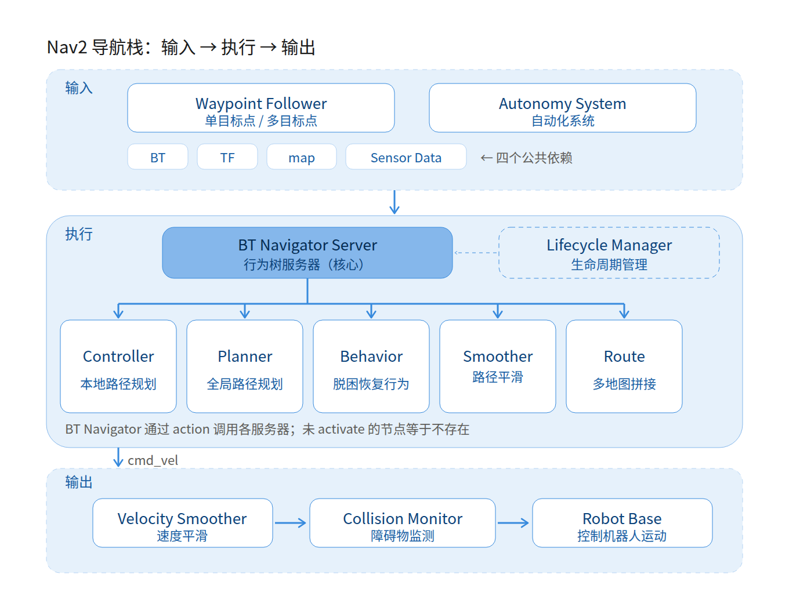

# Nav2 自主导航机器人项目规划

> 目标：从零走通 **URDF 建模 → Gazebo 仿真世界 → SLAM 建图 → Nav2 导航 → 调优评测** 的完整闭环，最终交付一个能复现、能评测、能讲清楚原理的导航项目。

---

## 0. 当前环境（已核查，不用再装）

| 组件 | 版本 / 状态 | 说明 |
|---|---|---|
| ROS 2 | Jazzy（`/opt/ros/jazzy`） | Ubuntu 24.04 对应版本 |
| Nav2 | 34 个包已安装 | 默认 `MPPI` 控制器 + `NavFn` 规划器，另有 `Smac`、`RPP`、`Graceful`、`nav2_route` |
| Gazebo | Harmonic（gz-sim 8.15） | 通过 `ros-jazzy-gz-sim-vendor` 提供 |
| ros_gz | 1.0.24 | `ros_gz_sim` / `ros_gz_bridge` / `ros_gz_image` |
| SLAM | `slam_toolbox`、`cartographer_ros` | 二选一，推荐 slam_toolbox |
| 控制 | `ros2_control`、`diff_drive_controller` | 真机阶段才需要，仿真阶段可用 gz 插件 |
| 其他 | `robot_localization`、`teleop_twist_keyboard` | EKF 融合、键盘遥控 |

**注意**：Jazzy 不再支持 Gazebo Classic（`gazebo_ros`）。网上大量教程用的是 `gazebo_ros` + `libgazebo_ros_diff_drive.so`，在你这套环境下**跑不通**，必须用 `ros_gz` + `gz::sim::systems::DiffDrive`。这是踩坑率最高的一点。

---

## 1. 项目定义（先明确边界，再动手）

### 1.1 项目假设（可按你的实际需求修改）

- 底盘：两轮差速 + 万向轮（也可换阿克曼，后面阶段 4 参数不同）
- 传感器：2D 激光雷达（`gpu_lidar`），可选 IMU / 深度相机
- 场景：室内约 10 m × 10 m，含走廊、门、窄通道、可移动障碍
- 运行方式：纯仿真（阶段 6 可选真机）

### 1.2 可验收的指标（写进 README，最后逐条打勾）

| 维度 | 指标 |
|---|---|
| 建模 | `check_urdf` 通过；RViz 中 TF 树完整；轮子转向/转速与指令一致 |
| 仿真 | 键盘遥控可行驶；`/scan`、`/odom`、`/tf`、`/clock` 全部正常且时间戳一致 |
| 建图 | 10×10 m 场景地图闭合、无重影、墙体厚度合理（≤2 层栅格） |
| 定位 | AMCL 从初始位姿收敛 < 3 s；静止时定位误差 < 0.1 m / 2° |
| 导航 | 10 个随机目标点成功率 ≥ 90%，平均耗时 < 40 s，无碰撞 |
| 动态 | 有行人横穿时能减速/绕行或停车等待，不碰撞 |
| 工程 | 一条 launch 启动全链路；参数全部外置 yaml；有批量评测脚本和 CSV 结果 |

---

## 2. 工作区结构（建议一开始就定好）

```text
moke-nav_ws/
├── src/
│   ├── nav_bot_description/     # URDF/xacro、meshes、rviz 配置
│   ├── nav_bot_gazebo/          # worlds/、models/、bridge 配置、spawn launch
│   ├── nav_bot_navigation/      # nav2_params.yaml、maps/、bt xml、导航 launch
│   ├── nav_bot_bringup/         # 一键启动：仿真 + 定位 + 导航
│   └── nav_bot_tools/           # 评测脚本、自定义 planner/controller 插件
├── docs/                        # 本文档、架构图、实验记录
└── bags/                        # ros2 bag 录制的数据
```

约定：
- 编译用 `colcon build --symlink-install`，改 Python/launch/xacro 不用重编
- 每个包 `package.xml` 依赖写全（`nav2_bringup`、`ros_gz_sim`、`xacro`…），否则 `rosdep` 检查不过
- 所有 launch 用 `DeclareLaunchArgument` 暴露 `use_sim_time`、`map`、`params_file`、`world`，方便切换仿真/真机

---

## 3. 阶段计划

### 阶段 1：URDF / Xacro 机器人建模（约 1 周）

**要产出的东西**：`nav_bot_description` 包，能在 RViz 里看到完整机器人并手动转轮子。

任务清单：

1. **link 三件套**：`visual`（外观，可用 mesh）、`collision`（碰撞体，**必须用简化几何体**）、`inertial`（质量 + 惯性张量，**不能省**）
2. **joint**：`fixed`（雷达、万向轮支架）、`continuous`（驱动轮，绕 y 轴）、`revolute`（万向轮）；注意 `axis`、`origin rpy`、`limit`
3. **xacro 参数化**：轮半径、轮距、车体尺寸、雷达高度全部写成 `<xacro:property>`，后面调参只改一处
4. **惯性张量计算**（最容易错的地方）：
   - 长方体：`Ixx = m(h²+d²)/12`，`Iyy = m(w²+d²)/12`，`Izz = m(w²+h²)/12`
   - 圆柱（绕自身轴为 z）：`Izz = m r²/2`，`Ixx = Iyy = m(3r²+h²)/12`
   - 轮子质量给 0.2~0.5 kg，车体 3~8 kg，别写成 1 kg 的"纸片车"
5. **Gazebo 扩展标签**：`<gazebo reference="wheel_link">` 里设置 `<mu1>/<mu2>` 摩擦、`<material>` 颜色，否则车轮打滑、模型全灰
6. **验证三件套**：
   ```bash
   check_urdf robot.urdf
   ros2 launch nav_bot_description display.launch.py   # rviz2 + robot_state_publisher + joint_state_publisher_gui
   ros2 run tf2_tools view_frames                     # 生成 frames.pdf 看树结构
   ```

**验收**：TF 树为 `base_footprint → base_link → {left_wheel, right_wheel, caster, laser_link}`；拖动 joint slider 轮子转动方向正确；车体不悬空、不陷地。

**这一步的典型错误**：
- `inertial` 缺失或质量为 0 → 进 Gazebo 后模型乱飞、瞬移
- 把高精度 mesh 同时当 `collision` → 物理计算爆炸、帧率暴跌
- 左右轮 `axis` 方向写成一致 → 一个前进一个后退，原地打转
- `base_footprint` 高度 ≠ 轮半径 → 车陷进地面或悬空，costmap 中心偏移

---

### 阶段 2：Gazebo Harmonic 仿真世界（约 1.5 周）

**要产出的东西**：`nav_bot_gazebo` 包，自定义 world + 可遥控的机器人 + 正确的 ROS 话题。

任务清单：

1. **world 文件**（SDF 1.9）：`<physics>` 步长建议 `max_step_size 0.001`、`real_time_factor 1.0`；加 `<include>` 地面、太阳、以及 Fuel 上的家具模型
2. **生成机器人**：
   ```bash
   ros2 run ros_gz_sim create -topic /robot_description -name nav_bot -z 0.05
   ```
   配合 `robot_state_publisher` 把 xacro 发布到 `/robot_description`
3. **差速驱动插件**（写在 URDF 的 `<gazebo>` 标签里，Gazebo 启动时读取）：
   ```xml
   <plugin filename="gz-sim-diff-drive-system" name="gz::sim::systems::DiffDrive">
     <left_joint>left_wheel_joint</left_joint>
     <right_joint>right_wheel_joint</right_joint>
     <wheel_separation>0.32</wheel_separation>   <!-- 必须等于 URDF 实际轮距 -->
     <wheel_radius>0.05</wheel_radius>           <!-- 必须等于 URDF 实际轮半径 -->
     <max_linear_velocity>0.6</max_linear_velocity>
     <max_angular_velocity>1.5</max_angular_velocity>
     <odom_topic>odom</odom_topic>
     <tf_topic>tf</tf_topic>
     <frame_id>odom</frame_id>
     <child_frame_id>base_footprint</child_frame_id>
     <odom_publish_frequency>50</odom_publish_frequency>
   </plugin>
   ```
4. **雷达**：`<sensor type="gpu_lidar">`，`<topic>scan</topic>`、`<gz_frame_id>laser_link</gz_frame_id>`，采样 360 线、10 Hz、量程 0.12~12 m；**`gz_frame_id` 必须和 URDF 的 link 名一致**，否则点云挂错坐标系
5. **ros_gz_bridge 配置**（yaml 形式，别用一长串命令行）：
   | ROS 话题 | 方向 | 类型 |
   |---|---|---|
   | `/clock` | GZ → ROS | `rosgraph_msgs/msg/Clock` |
   | `/scan` | GZ → ROS | `sensor_msgs/msg/LaserScan` |
   | `/odom` | GZ → ROS | `nav_msgs/msg/Odometry` |
   | `/tf` | GZ → ROS | `tf2_msgs/msg/TFMessage` |
   | `/cmd_vel` | ROS → GZ | `geometry_msgs/msg/Twist` |
   | `/joint_states` | GZ → ROS | `sensor_msgs/msg/JointState` |
6. **`use_sim_time:=true`**：`robot_state_publisher`、`rviz2`、`slam_toolbox`、所有 nav2 节点都要开，缺一个就会 TF 时间戳错乱
7. **建自己的 world**：墙体（薄 box）、两扇门（一窄一宽）、一条 1.2 m 宽走廊、几个圆柱/箱子障碍。用 `gz sim` 的模型编辑器摆，或直接写 SDF

**验收**：
```bash
ros2 run teleop_twist_keyboard teleop_twist_keyboard --ros-args -p use_sim_time:=true
ros2 topic hz /scan /odom /tf
ros2 run tf2_ros tf2_echo odom base_footprint
```
机器人能前进、转向；`/scan` 在 RViz 里贴合墙面不穿墙；`/odom` 位移与视觉一致。

**典型错误**：
- 只桥接了 `/scan`，忘桥 `/clock` → 全链路时间戳为 0，RViz 报 "message removed because timestamp is too old"
- 同时开 `ros2_control` 的 `diff_drive_controller` 和 gz `DiffDrive` 插件 → 两套 TF 打架，odom 抽搐
- 插件里 `wheel_separation` 与 URDF 不一致 → 走 1 m 里程计只报 0.8 m，AMCL 永远收敛不好
- 雷达 `<topic>` 与 bridge 里 `gz_topic_name` 不一致 → 静默无数据

---

### 阶段 3：SLAM 建图（约 1 周）

**要产出的东西**：`maps/` 下的 `map.pgm` + `map.yaml`。

任务清单：

1. `slam_toolbox` 的 `online_async_launch.py`，参数：
   - `resolution: 0.05`、`max_laser_range: 12.0`
   - `minimum_travel_distance: 0.3`、`minimum_travel_heading: 0.3`
   - `transform_publish_period: 0.02`、`map_update_interval: 1.0`
   - `mode: mapping`（定位阶段改 `localization`）
2. **建图技巧**：速度降到 0.3 m/s；转弯慢，避免雷达运动畸变；走闭合回路（loop closure）；每个房间都进去转一圈
3. 保存：
   ```bash
   ros2 run nav2_map_server map_saver_cli -f src/nav_bot_navigation/maps/room
   ```
4. 手工修图：GIMP/图像编辑器把地图外的孤立噪点涂成未知（205 灰），保留墙体（0 黑）
5. 可选：`cartographer_ros` 对比效果，作为报告里的"方案对比"

**验收**：地图墙体连贯、门洞两侧墙面不粘连、没有"重影双墙"；地图尺寸与实际场景误差 < 5%。

---

### 阶段 4：Nav2 导航栈打通（约 2 周，核心阶段）

**要产出的东西**：一条 launch 启动 map_server + amcl + nav2，RViz 点击目标能自主到达。

**4.1 先理解架构，再改参数**

```text
                    ┌─ bt_navigator（行为树调度）
                    │      └─ NavigateToPose（action 接口）
     RViz / 脚本 ───┤
                    ├─ planner_server（全局：NavFn / Smac）
                    ├─ controller_server（局部：MPPI / DWB / RPP）
                    ├─ smoother_server（路径平滑）
                    ├─ behavior_server（Spin / BackUp / Wait）
                    ├─ velocity_smoother（加减速限制）
                    ├─ waypoint_follower（多点巡航）
                    └─ lifecycle_manager（统一管理节点生命周期）
```

#### 4.1.1 架构图逐层拆解（输入 / 执行 / 输出）



*图 4-1　Nav2 导航栈的三层结构（由架构原图整理重绘；矢量版见 `images/nav2_navigation_stack.svg`，可无损缩放与二次编辑）*

原图左右两半画的是同一套东西：左半是 Nav2 的真实组件（蓝底大框内全是生命周期托管节点），右半是中文概念图。下面把每个框、每条连线都落到文字上，方便脱离图片直接读；表格顺序与图中从左到右、从上到下的位置一致。

**① 输入层（顶部两个虚线框 + 左侧四个公共入口）**

| 图中名称 | 中文对应 | 说明 |
|---|---|---|
| Waypoint Follower | 单目标点 / 多目标点 | 依次下发一串目标点做多点巡航（`nav2_waypoint_follower`，走 `FollowWaypoints` action） |
| Autonomy System | 自动化系统 | 上层任务调度，决定"去哪、干什么"，通过 action 调导航 |
| BT | 行为树 | 行为树 XML，决定"先规划还是先脱困" |
| TF | TF 变换 | `map→odom→base_link` 坐标链，缺一段全链路就废 |
| map | 地图 | 静态栅格地图，全局规划的底图 |
| Sensor Data | 传感器数据 | 激光 / 点云 / 里程计，喂给局部代价地图 |

**② 执行层（蓝底框：六个 Server + 一个 Manager）**

| 组件 | 中文说明 | 职责 | 关键依赖 |
|---|---|---|---|
| BT Navigator Server（BT Plugin） | 行为树服务器（核心） | 读行为树编排整个导航流程，向其它 server 发 action；失败时触发恢复分支 | BT XML、各 server 的 action 接口 |
| Planner Server（Global Costmap → Planner Plugin） | 全局路径规划 | 在全局代价地图上搜起点到目标的路径（NavFn / Smac） | 静态地图 + 全局 costmap |
| Controller Server（Local Costmap → Controller Plugin） | 运动控制（本地路径规划） | 跟踪全局路径、实时避障，输出 `cmd_vel` | 局部 costmap + 传感器数据 |
| Behavior Server（Controller Plugin） | 恢复行为 | 卡住 / 被围时执行 Spin、BackUp、Wait 等脱困动作 | 局部 costmap |
| Smoother Server（Costmap Sub / Footprint Sub） | 路径平滑 | 把折线路径修成满足曲率与 footprint 约束的平滑轨迹 | 路径、footprint、costmap |
| Route Server | 多地图拼接 / 长程路由 | 跨多张地图的长距离路线规划 | 多张地图、路由图 |
| Lifecycle Manager | 生命周期管理 | 统一 configure / activate / deactivate 所有托管节点，保证启动顺序 | 节点清单 |

**③ 框中连线的含义（谁调谁）**

- `BT Navigator → Controller / Planner / Behavior / Smoother`：全部走 action（`ComputePathToPose`、`FollowPath`、`Spin`、`SmoothPath`），图里的双向箭头表示"请求 + 结果回传"
- `Controller ↔ Planner`：控制器拿规划器的路径；两者各持一份 costmap（局部 rolling / 全局 static）
- `Smoother ↔ Planner`：平滑器接收规划结果，回传平滑后的路径
- `所有节点 ↔ Lifecycle Manager`：状态受管，未 activate 的节点等于不存在（"导航完全没反应"多半是这里）
- 右侧图的"依赖：行为树 / TF 变换 / 地图 / 传感器数据"就是左侧这四根竖排箭头的文字版

**④ 输出层（底部三个虚线框）**

| 图中名称 | 中文对应 | 说明 |
|---|---|---|
| Velocity Smoother | 速度平滑 | 限制加速度 / 加加速度，防止起步停车抖动（`nav2_velocity_smoother`） |
| Collision Monitor | 障碍物监测 | 独立安全兜底，检测到即将碰撞直接截断或改写速度指令 |
| Robot Base | 控制机器人运动 | 底盘执行层：仿真里是 gz `DiffDrive` 插件，真机是 `ros2_control` + `diff_drive_controller` |

> 容易看混的两组：`Smoother Server（路径平滑）` 处理的是**路径**，`Velocity Smoother（速度平滑）` 处理的是**速度指令**，一个在规划侧、一个在输出侧；`Behavior Server（恢复行为）` 才是"车辆陷入困境时脱困"，不要和 `Route Server（多地图拼接）` 搞混。

**⑤ 把图串成一条链路**

```text
目标点（Waypoint Follower / 自动化系统）
  → BT Navigator 读行为树，把任务拆成 规划 / 跟踪 / 恢复
  → Planner Server：全局 costmap 上出全局路径
  → Smoother Server：路径平滑
  → Controller Server：局部 costmap + 传感器跟踪路径，出 cmd_vel
       （卡住 → Behavior Server 脱困 → 回到规划）
  → Velocity Smoother：限加速度
  → Collision Monitor：安全兜底
  → Robot Base → 轮子转动
  ↑ 全程 Lifecycle Manager 管状态；TF 与 map 提供坐标与先验
```

全局链路一句话：`/map` + `/scan` → costmap → 全局路径 → 局部 costmap → `cmd_vel` → 差速插件 → 轮子。

**4.2 关键配置文件**

- **map_server**：`yaml_filename` 指向你的地图，`topic_name: map`，`frame_id: map`
- **amcl**：
  ```yaml
  alpha1: 0.2            # 里程计旋转噪声
  alpha2: 0.2
  alpha3: 0.2
  alpha4: 0.2
  max_particles: 2000
  min_particles: 500
  laser_max_range: 12.0
  update_min_d: 0.1      # 移动 10cm 才更新，太小会吃满 CPU
  update_min_a: 0.2
  transform_tolerance: 0.5
  set_initial_pose: false
  ```
  启动后必须在 RViz 用 **2D Pose Estimate** 给初始位姿，否则粒子撒满地图
- **costmap（全局/局部各一份）**：
  - `resolution: 0.05`，`robot_radius` 或 `footprint: [[x,y],...]` 多边形（推荐多边形，窄门更敢过）
  - `inflation_radius: 0.35`，`cost_scaling_factor: 3.0`（默认 10 太陡，贴墙走）
  - 全局层：`static_layer` + `obstacle_layer` + `inflation_layer`
  - 局部层：`voxel_layer`（有 3D 传感器时）+ `obstacle_layer` + `inflation_layer`，`rolling_window: true`
- **planner**：`NavFn`（Dijkstra/A*）够用；车体约束强时换 `SmacPlanner2D` 或 `SmacPlannerHybrid`
- **controller**：Jazzy 默认 `MPPI`，先跑通再调：
  ```yaml
  FollowPath:
    plugin: "nav2_mppi_controller::MPPIController"
    time_steps: 56
    model_dt: 0.05
    batch_size: 1000
    vx_max: 0.5
    vx_min: -0.2
    wz_max: 1.2
    iteration_count: 1
  ```
  调不动可以切 `DWB` 对比（`nav2_dwb_controller`），报告里做横向对比很有说服力
- **行为树**：默认 `navigate_to_pose_w_replanning_and_recovery.xml`，先读懂再改。想加"窄通道减速"就在 `<RateController>` 里插自定义子树

**4.3 启动与验证顺序（不要跳步）**

```bash
# 1. 只起仿真和机器人
ros2 launch nav_bot_gazebo sim.launch.py
# 2. 起地图 + AMCL，RViz 给初始位姿，看粒子云收敛
ros2 launch nav_bot_navigation localization.launch.py
# 3. 起导航栈
ros2 launch nav_bot_navigation navigation.launch.py
# 4. 检查代价地图是否正常（RViz 打开 global/local costmap）
# 5. 点 2D Goal Pose
```

**验收**：10 个目标点 ≥ 8 个成功；路径不贴墙；卡住时能看到 recovery（后退/旋转）后继续。

**典型错误**：
- `use_sim_time` 没统一 → costmap 不更新、AMCL 不收敛（**头号问题**）
- 忘给初始位姿 → 全局路径从错误位置出发，穿墙
- `inflation_radius` 过大 → 1 m 宽的门被"堵死"，永远规划失败
- `footprint` 比车实际大 → 门口来回抖动、反复重规划
- `controller_frequency` 与仿真步长不匹配 → 抖车、原地画圈
- `xy_goal_tolerance` 太小（0.05）→ 到不了点，一直转

---

### 阶段 5：调优、评测与自研算法（约 2 周）

**5.1 建立评测基线**（这是让项目"像个工程"的关键）

用 `nav2_simple_commander` 写批量脚本，输出 CSV：

```python
from nav2_simple_commander.robot_navigator import BasicNavigator, TaskResult
# 对每个目标点：记录 起点、目标、耗时、路径长度、是否成功、recovery 次数
```

指标定义：

| 指标 | 定义 | 目标 |
|---|---|---|
| 成功率 | 成功到达 / 总任务 | ≥ 90% |
| 平均耗时 | 单任务从发目标到到达 | < 40 s |
| 路径效率 | 实际路径长 / 直线距离 | < 1.3 |
| 最小间距 | 与障碍物最小距离 | > 0.15 m |
| 舒适度 | 角速度变化率、加速度峰值 | 无剧烈抖动 |

**5.2 场景化测试**（每个场景单独世界或随机摆放）

窄门通过、长走廊、目标在障碍后（需绕行）、动态行人横穿、地图与实际不一致（放一个未建模箱子）。

**5.3 参数敏感性实验**

固定其他参数，扫 `inflation_radius`（0.25/0.35/0.45）、`max_vel_x`（0.3/0.5/0.8）、控制器（MPPI vs DWB），画成功率-速度曲线。这张图就是报告的核心结论。

**5.4 自研插件（"算法实现"的落点）**

两种选择：

- **自定义全局规划器**：继承 `nav2_core::GlobalPlanner`，实现 `createPlan()`，用 `pluginlib` 导出，参数里换掉 `plugin`
- **自定义局部控制器**：继承 `nav2_core::Controller`，实现 `computeVelocityCommands()`，可做纯跟踪 / PID 追踪 / 简单 MPC

最小骨架：

```cpp
class MyPlanner : public nav2_core::GlobalPlanner {
public:
  void configure(...) override;
  nav_msgs::msg::Path createPlan(const geometry_msgs::msg::PoseStamped & start,
                                 const geometry_msgs::msg::PoseStamped & goal) override;
};
PLUGINLIB_EXPORT_CLASS(my_planner::MyPlanner, nav2_core::GlobalPlanner)
```

在 `nav2_params.yaml` 里：

```yaml
planner_server:
  ros__parameters:
    planner_plugins: ["GridBased"]
    GridBased:
      plugin: "my_planner/MyPlanner"
```

**验收**：同一组 10 个目标，自研算法与默认算法各跑一遍，指标表并排放，说明优劣（哪怕只是"更平滑但更慢"也是结论）。

---

### 阶段 6：可选 —— 真机 / 交付（约 1 周）

- 把 gz `DiffDrive` 换成 `ros2_control` + `diff_drive_controller`（真机必须）
- 传感器驱动发布 `sensor_msgs/LaserScan`、`nav_msgs/Odometry`、`/tf`
- `robot_localization` 做 EKF 融合（轮式 + IMU）
- micro-ROS / 串口桥接下位机
- 交付物：README（一键启动）、架构图、参数说明表、实验数据、演示视频

---

## 4. 技术栈分层

| 层 | 技术 | 关键技术点 |
|---|---|---|
| 建模 | URDF / Xacro | link-joint 树、惯性张量、collision 简化、`<gazebo>` 扩展 |
| 仿真 | Gazebo Harmonic（gz-sim 8）/ SDF | world 结构、物理步长、系统插件、传感器渲染 |
| 桥接 | ros_gz_bridge / ros_gz_sim | 话题双向映射、`/clock` 同步、`use_sim_time` |
| 状态估计 | TF2、robot_state_publisher、AMCL、EKF | 坐标链、粒子滤波、里程计噪声建模 |
| 建图 | slam_toolbox（或 cartographer） | 图优化、回环、栅格分辨率 |
| 规划 | NavFn / Smac 2D / Hybrid A* | 图搜索、代价地图、启发式、运动学约束 |
| 控制 | MPPI / DWB / RPP、velocity_smoother | 采样优化、差速运动学、加速度限制 |
| 调度 | BehaviorTree.CPP + Nav2 BT XML | 行为树节点、recovery 策略 |
| 框架 | ROS 2（rclcpp/rclpy）、pluginlib、launch | 生命周期节点、插件机制、参数化启动 |
| 工程 | colcon、ros2 bag、RViz 配置、Git | 可复现构建、数据回放、版本管理 |

---

## 5. 需要掌握的知识（按优先级）

### 必修（不会就寸步难行）

1. **ROS 2 通信模型**：topic / service / action 的区别与适用场景；QoS（传感器用 `best_effort`，地图和 TF 用 `reliable`）；LifecycleNode 为什么存在（Nav2 全是托管节点）
2. **TF2**：四元数与 rpy 转换；静态变换 vs 动态变换；为什么必须有两段 `map→odom` 和 `odom→base_link`（前者修正累积误差、后者保证连续）
3. **URDF 物理属性**：质量、惯性张量、摩擦系数对仿真的影响；`collision` 与 `visual` 分离的意义
4. **Gazebo 插件机制**：SDF 与 URDF 的关系（URDF 转 SDF）；系统插件如何订阅 `cmd_vel`、发布 `odom`
5. **概率机器人基础**：占用栅格地图、贝叶斯更新、粒子滤波（AMCL 的本质）、里程计漂移来源
6. **图搜索**：Dijkstra / A* / Hybrid A*；costmap 代价值如何影响路径；启发函数可采纳性
7. **局部规划**：DWA 的采样-评价-选择流程；MPPI 的采样+滚动优化思想；纯跟踪的预瞄距离作用
8. **差速运动学**：`v = (v_r + v_l)/2`、`ω = (v_r - v_l)/L`；轮距/轮半径误差如何放大成里程计误差
9. **调试方法论**：先看 TF，再看话题频率，再看 costmap，最后才看参数（顺序反了会浪费几天）

### 选修（决定项目上限）

- BehaviorTree.CPP 语法与自定义 BT 节点
- C++ 插件开发（`pluginlib`、`nav2_core` 接口）
- `ros2_control` 框架与硬件接口
- 卡尔曼滤波 / EKF 多传感器融合
- 强化学习局部规划（如 DRL-based local planner）
- 多机器人导航（`nav2_route`、命名空间隔离）
- Docker 化与 CI（`colcon test`、`ros2 launch testing`）

### 自测题（能答上来就算过关）

1. 为什么不能只发 `map→base_link` 一个变换？
2. `inflation_radius` 和 `robot_radius` 是什么关系？设太大/太小分别什么现象？
3. AMCL 的粒子什么时候会"全军覆没"，怎么恢复？
4. 机器人在 RViz 里"穿墙"，最可能是哪三层里哪一层的问题？
5. 仿真里车走得比里程计快，先怀疑哪个参数？
6. `controller_frequency` 从 20 改到 5，会发生什么？

---

## 6. 常用参数速查

| 参数 | 位置 | 建议初值 | 说明 |
|---|---|---|---|
| `wheel_separation` / `wheel_radius` | gz DiffDrive | 与 URDF 严格一致 | 不一致则里程计尺度错 |
| `resolution` | costmap / map | 0.05 | 越小越精细越吃 CPU |
| `robot_radius` / `footprint` | costmap | 按实际外形 | 有形状优先用 footprint |
| `inflation_radius` | costmap | 0.3~0.4 | 需 > 内切半径 + 安全余量 |
| `cost_scaling_factor` | costmap | 2.0~3.0 | 越大越敢贴障碍 |
| `controller_frequency` | controller_server | 15~20 Hz | 太低跟不上，太高抖 |
| `max_vel_x` / `max_vel_theta` | controller | 0.4~0.6 / 1.0~1.5 | 与电机能力匹配 |
| `xy_goal_tolerance` | goal_checker | 0.15~0.25 m | 太小到不了 |
| `transform_tolerance` | amcl / costmap | 0.3~0.5 s | 太小 TF 偶发超时 |
| `max_particles` | amcl | 1000~2000 | 大场景可到 5000 |

---

## 7. 症状 → 原因速查表

| 症状 | 最可能原因 |
|---|---|
| 模型一进 Gazebo 就乱飞/瞬移 | `inertial` 缺失或质量为 0 |
| 车轮打滑、上坡上不去 | `<mu1>/<mu2>` 未设置或过小 |
| RViz 无 scan，但 gz 里有 | bridge 话题名不匹配 / 方向写反 |
| TF 报 "timestamp too old" | `use_sim_time` 未统一 / `/clock` 未桥接 |
| odom 抽搐、机器人抖动 | 两处同时发布 `odom→base_link` |
| 地图重影、双墙 | 建图速度过快 / 回环未闭合 / 雷达外参错 |
| AMCL 粒子撒满全图不收敛 | 未给初始位姿 / 地图与 scan 尺度不一致 |
| 全局路径穿墙 | 静态地图质量差 / 全局 costmap 未加载 static_layer |
| 门前反复进退 | `inflation_radius` 过大 / footprint 过大 / 代价地图分辨率粗 |
| 到点后原地打转 | `xy_goal_tolerance` 过小 / `yaw_goal_tolerance` 过小 |
| 规划成功但不动 | `cmd_vel` 未桥接到 gz / 速度被 `velocity_smoother` 限成 0 |
| 导航完全没反应 | `lifecycle_manager` 未激活节点（`ros2 lifecycle get` 查） |

---

## 8. 时间表（按每周 12~15 小时）

| 周 | 内容 | 里程碑 |
|---|---|---|
| 1 | ROS 2 基础 + TF2 + 阶段 1 建模 | URDF 在 RViz 中正确显示 |
| 2 | 阶段 2 仿真世界 + 差速插件 + 雷达桥接 | 键盘遥控跑起来 |
| 3 | 自定义 world 搭建 + 传感器调试 + 阶段 3 建图 | 得到可用地图 |
| 4-5 | 阶段 4：AMCL + costmap + planner + controller | 单点导航成功 |
| 6 | 阶段 4 收尾：行为树、recovery、异常场景 | 10 目标 ≥ 8 成功 |
| 7 | 阶段 5：评测脚本 + 场景化测试 + 参数实验 | 基准数据表 |
| 8 | 阶段 5：自研插件 + 对比实验 | 算法对比结论 |
| 9（可选） | 真机迁移 / 文档整理 / 演示 | 完整交付物 |

---

## 9. 学习资源

- Nav2 官方文档：`docs.nav2.org`（配置向导 + 调参指南，最权威）
- Gazebo Harmonic 文档：`gazebosim.org/docs/harmonic`（SDF 与插件部分）
- ROS 2 Jazzy 教程：`docs.ros.org/en/jazzy`
- 参考视频系列：Articulated Robotics 的 ROS 2 机器人教程（URDF→Gazebo→Nav2 全流程，思路与本文一致）
- 参考实现：`nav2_bringup` 里的 `nav2_params.yaml` 和 TB3/TB4 示例（**先跑通它，再改自己的**）
- 论文：DWA（Fox 1997）、MPPI（Williams 2017）、AMCL（Thrun《Probabilistic Robotics》第 8 章）

---

## 10. 机器人部件清单

### 10.1 必备件（跑通 2D Nav2 的最小配置）

| 部件 | 作用 | 数据/接口 | 仿真对应 | 选型建议（真机） |
|---|---|---|---|---|
| 车架底盘 | 承载所有部件 | — | URDF `base_link` 尺寸 | 铝型材/双层亚克力，≥ 25×20 cm |
| 直流减速电机 ×2 | 驱动轮 | PWM | gz DiffDrive 插件 | 12V 减速电机，配 泰坦/乐高式联轴器 |
| 轮式编码器 ×2 | 轮速反馈 → 里程计 | AB 相脉冲 | 插件内部积分 | 磁编码器（霍尔）优先，精度 > 光栅 |
| 驱动轮 ×2 + 万向轮 ×1 | 差速运动结构 | — | URDF wheel/caster link | 轮径 65~80 mm，万向轮在后 |
| 电机驱动板 | MCU→电机功率放大 | PWM/串口 | 无（插件替代） | TB6612（小电流）/ BTS7960（大电流） |
| 下位机 MCU | 读编码器、PID、差速运动学、上报里程计 | USB 串口 / micro-ROS | 无（插件替代） | STM32F4 / ESP32 |
| 上位机（主控电脑） | 跑 ROS 2 + Nav2 全栈 | — | 你的开发机 | 树莓派 5 / Jetson Orin Nano / NUC |
| 2D 激光雷达 | SLAM 建图 + 避障（**核心传感器**） | `sensor_msgs/LaserScan`，串口或 USB | `<sensor type="gpu_lidar">` | 思岚 C1 / RPLIDAR A1 / YDLIDAR X2，10 m 量程、360° |
| IMU（6/9 轴） | 角速度/加速度，配合里程计做 EKF | `sensor_msgs/Imu` | `<sensor type="imu">` | MPU6050（入门）/ WHEELTEC N100（正式） |
| 锂电池 | 供电 | — | 无 | 12V 3S/4S，容量 ≥ 3000 mAh |
| DC-DC 降压模块 | 12V→5V 给上位机、雷达供电 | — | 无 | 5V 5A 以上，注意独立供电防复位 |
| 急停开关 + 电源开关 | 安全 | — | 无 | 必装，串在主电路 |
| 电机驱动板散热/固定件 | — | — | — | 铜柱、扎带、3M 胶 |

### 10.2 推荐件（明显提升导航能力）

| 部件 | 作用 | 数据/接口 | 仿真对应 | 选型建议 |
|---|---|---|---|---|
| 深度相机 | 3D 避障、负障碍（台阶/坑）、物体识别 | `sensor_msgs/PointCloud2` / Image | `<sensor type="rgbd_camera">` | RealSense D435i / 奥比中光 Astra |
| 普通摄像头 | 视觉巡线、二维码/目标识别 | `sensor_msgs/Image` | `<sensor type="camera">` | USB 免驱相机即可 |
| 超声波传感器 ×2~4 | 雷达近距盲区（< 0.15 m）补盲 | GPIO/串口 | `<sensor type="gpu_lidar">` 限距模拟 | HC-SR04 |
| 防撞条（bumper） | 物理碰撞最后一道防线 | GPIO 中断 | 无 | 微动开关 + 泡棉 |
| 磁力计/电子罗盘 | 修正航向漂移（9 轴 IMU 自带） | Imu 消息 | — | 与 IMU 一体化 |

### 10.3 可选件（进阶场景）

| 部件 | 作用 | 适用场景 |
|---|---|---|
| GPS + RTK | 室外厘米级定位 | 园区/室外导航 |
| 4G/Wi-Fi 热点模块 | 远程监控、多机协同 | 实车部署 |
| OLED 状态屏 / LED | 电量、任务状态显示 | 演示与调试 |
| 麦克风阵列 | 语音指令下发 | 人机交互 |
| 云台 | 相机稳定 + 转向 | 巡检类任务 |
| 机械臂 | 导航 + 操作一体化（nav2 可配 Nav2 + MoveIt） | 服务机器人 |

### 10.4 部件与 Nav2 的关系（理解这张表，少买错东西）

```text
激光雷达 ──→ SLAM 建图 / AMCL 定位 / costmap 避障   ← 没有它 Nav2 2D 导航无法工作
IMU ───────→ EKF 融合里程计（robot_localization）  ← 没有也能跑，但急转弯会漂
编码器 ────→ 轮式里程计 odom→base_link TF          ← 里程计的"腿"
深度相机 ──→ voxel_layer 3D 避障（桌腿、悬空障碍）  ← 2D 雷达扫不到的它来补
摄像头 ────→ 与导航无直接关系，属感知扩展
超声波 ────→ 近距避障冗余                          ← 可选
```

**结论**：最小可用清单 = 底盘 + 2×电机 + 编码器 + 万向轮 + 驱动板 + MCU + 上位机 + 2D 激光雷达 + IMU + 电池 + 降压模块。仿真阶段只需要 URDF 里的几何尺寸和质量参数；真机阶段才涉及选型采购。

---

## 11. 起步建议（避免走弯路）

1. **先用 TB3/TB4 跑通全链路**（`ros2 launch nav2_bringup tb4_sim.launch.py`，环境里已有 `nav2_minimal_tb4_sim`），确认 Nav2 本身没问题，再换自己的机器人。这样出问题时能快速定位是"我的模型错了"还是"Nav2 配错了"。
2. **严格按阶段验收**，不要跳过建图直接调导航——地图错了，后面所有调参都是白费。
3. **每次实验前录 bag**：`ros2 bag record -a`，出问题能回放复现，比截图有效得多。
4. **参数改动一次只改一个**，记录在 `docs/experiments.md` 里，否则最后说不清哪个参数起了作用。
5. **优先做能出数据的事**：一张"成功率 vs 最大速度"的图，比十段调参过程更有价值。
